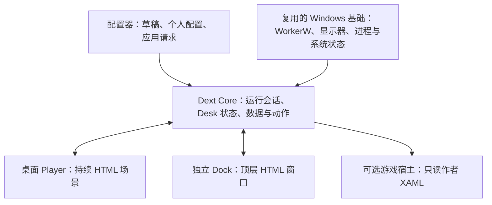

# Dext v3 总体设计与交付方案

> 2026-09-27，设计草案第 1 版。根据用户要求整合概念、细节确认、Core 改写和 UI 修改。
> 本文是 v3 设计方案的阅读入口；已确认的产品方向、建议的实现和待决定的问题在文中分别标明。实际工作包顺序与状态只认 [ROADMAP](ROADMAP.md)，分支步骤只认 [TODO](TODO.md)。
> 2026-09-28 用户明确要求直接开始写新内核，`V3-CORE-001` 已按 [WORKFLOW](WORKFLOW.md) 独立开工。P2 关键实验与 P3 完整作品契约仍是后续集成门槛；先写会话状态基础不等于这些阶段已通过。

**目标：**在 Dext 自带的 Lively fork 上改写运行核心，以一套 Room/Desk 规则承载连续 HTML 桌面、可配置应用入口、模板 Dock 和可选游戏只读视图，让简单素材用户与高级作者都能完成创作、预览、使用和分享。

**架构方向：**保留 Windows 桌面承载、显示器管理和 Player 进程等可复用基础，建立 Dext 自己的状态、数据、动作和呈现宿主边界。HTML 桌面与顶层 HTML Dock 使用同一套状态语义；作者另供的游戏 XAML 由独立宿主研究承载。Core 指应用运行服务，不涉及开发 Windows 内核或驱动。

**当前技术基础：**React/TypeScript + Tauri/Rust 配置器；C#/.NET 9 WPF Core fork；.NET Framework 4.7.2 WinForms/WebView2 Player；HTML/CSS/JS 桌面。游戏 Game Bar/UWP XAML 为待验证候选。框架升级、换浏览器内核或移动源码目录都需要具体收益和独立验证，不与首次状态改写捆绑。

**2026-09-28 讨论修正：**“不兼容旧版本”和“v3 支持哪些内容能力”分开决定。前者已确认无需迁移；v3 基础版先逐项验证图片、视频、GIF、Room 内打包的本地 HTML 网页的完整使用链，通过后才发布。GIF 可作为网页素材，不预设独立播放器。**不提供输入在线网址、直接把外部网站设为壁纸的入口。**远程视频流、音频可视化、独立程序、Unity、Godot、BizHawk 等仅列后续候选，不在基础版承诺；以后若研究联网媒体，也不能等同于加载任意外部网页。游戏内自定义监控外观及 XAML 宿主也推迟到基础能力完成后再研究。

**依据：**[产品讨论](V3_IDEAS.md)、[运行模型](V3_RUNTIME_MODEL.md)、[作者接口研究](V3_API_NOTES.md)、[可行性复核](V3_FEASIBILITY.md)。[V2_TO_V3_TODO](V2_TO_V3_TODO.md)保留此前迁移清单与讨论顺序，后续按本文组织设计确认。现行正式实现契约仍是 v2 的 [MODEL](MODEL.md)、[DOCK](DOCK.md) 和 [ROOM_AUTHORING](ROOM_AUTHORING.md)。

## 1. 已确认的概念与产品方向

| 概念 | 已确认的含义 | 对开发的要求 |
|---|---|---|
| Dext | 管理用户应用、个人绑定、图标皮肤、权限和系统行为的产品 | 更换外观与分享作品不能泄漏或强制重建个人目标 |
| Room | 一份桌面作品，作者自己定义 Desk 数量、名称、内容和共同风格 | “游戏”“生活”只是举例，不是内置 Desk 类型 |
| Desk | Room 中的页面/场景状态，可以是持续网页的不同视角 | 切页必须对应 Dext 的 Desk 状态；图标与 Widget 参与同一次画面过渡 |
| 连续 HTML 场景 | 图片、视频、普通图标、作者按钮和组件共同参与网页画面 | 允许多个源文件；不强制单个 HTML 文件或 Canvas 技术 |
| Room 共享内容 | 可选的跨 Desk 内容；对象可以保留且不变，也可按 Desk 改变数据、大小或角色 | 需要持续实例和明确生命周期；不能用一个“Dock 可变”开关概括所有对象 |
| 背景、交互、Dock | 代码组织与呈现角色；同一元素可随 Desk 改变角色 | 不实现 PS 式强制分层编辑；交互、叠放、占用和权限分别表达 |
| 统一按钮 | 先声明按钮，再配置动作；Dext 能枚举并定位作者提供的按钮 | 默认图标、自绘图标和画面按钮可同时存在，也可打开同一目标 |
| 普通图标与皮肤 | 保留现有默认体验；允许用户选择皮肤或作者自绘入口；Room 作者可预设普通图标的区域/初始布局 | 导入后这些位置先为空，由使用者指定应用并可继续调整；具体应用绑定和个人皮肤选择属于 Dext 本机数据，不随分享带出 |
| 占用区 | 作者声明的不可放置区域，阻止普通图标和普通 Widget 放入 | 区域不能只靠 z-index 或透明像素推断，需布局变化后的有效几何 |
| Dock | 可选，导航与应用入口不必集中在固定栏里 | 无 Dock、左右分离按钮、仅键盘导航均有表达方式 |
| 简单创作 | 保留节点路线图，面向照片/视频、默认图标与模板 Dock 用户 | 不要求写代码或调用 AI；不要求路线图制作任意连续变形动画 |
| 高级创作 | 作者直接编辑 Room 内的本地 HTML/CSS/JS，可使用自己选择的 AI 工具 | 视觉创作自由；系统数据和动作只经 Dext 受控作者 API，不提供在线网址壁纸入口 |
| Dock 模板 | 外观自带点击区、展示槽位及响应式位置 | 使用者配置动作和显示数据，不重新划区域 |
| Dock 节点关系 | Dock 外观 → 默认共用的 Dock 交互 → 多个 Desk；Desk 需要差异时点连接线上的“＋”添加属性 | 默认相同、按需覆盖；配置连线与 Desk 切页线必须清楚区分 |
| 系统 Dock 窗口 | 普通最大化软件前可交互；支持自动隐藏、常驻占位 | v3 首轮同屏只用一个独立原生 Dock 窗口；桌面场景里的按钮可自由分布，不要求都进入 Dock。窗口行为由 Windows 宿主实现；HTML 占用区仅影响 Dext 内部布局 |
| 游戏内视图（候选） | 用户希望在游戏中显示自定义外观与实时数据，且不交互 | XAML/Game Bar 只是待验证路径；如保留该功能，作者内容应独立于桌面 Dock 模板，无内容则不显示；不列为 v3 桌面主线必做 |
| 分享 | 分享外观、资源、入口及获准的通用 Dext 默认动作 | 个人应用/文件/网址目标、授权、待办等个人值不随作品分享 |
| Core 改写 | 基于现有 Lively fork，按 Dext 需求逐步改写 | 保留可复用的 Windows 承载与播放器代码；v3 作品只按 Dext Room 定义，不为旧格式增加兼容链 |

作者获得视觉创作能力，系统动作仍由 Dext 处理。普通 Widget 不因能画按钮而自动取得启动应用或切页权限；哪些组件可声明哪些动作，需要统一按钮体验与权限契约共同确定。

早期“每个 Desk 只能有一个 Dock Widget”不直接作为 v3 限制。Room 共享对象、Desk 配置与独立原生窗口出现后，实例数量及归属要在细节阶段重新确认。

## 2. 概念落到作品与个人数据

以下是建议的职责分配，具体文件名和 Schema 在细节确认后冻结。

| 所有者 | 保存内容 | 生命周期 |
|---|---|---|
| 可分享作品包 | Room/Desk 定义、HTML/CSS/JS、图片/视频、模板区域声明、作者默认 Dext 动作、可选游戏 XAML 与资源 | 每次分享是一份作品，不建立作者作品的版本链；导入与卸载按作品身份处理，格式兼容单独处理 |
| 编辑器草稿 | 节点位置、资源引用、未保存改动、撤销历史 | 草稿、保存与运行中的安装版本分开 |
| Dext 个人配置 | 应用目标、入口绑定、图标皮肤选择、用户动作覆盖、待办/倒计时值、窗口偏好和授权 | 持久化在本机；按最终身份规则关联 Room/Desk/入口 |
| 运行会话 | 当前 Room/Desk、过渡状态、组件实例、当前窗口/显示器信息和数据订阅 | Core/Player 启动、切 Room、断线恢复时重建或收敛 |

路线图中的节点不是进程，也不是一个节点必须对应一个 WebView。共享外观、交互配置和 Desk 的引用关系不得自动等同于 DOM 实例数量。

“全局应用 + 当前 Desk 应用”是同一本机应用库的展示分配。此前确认的方向是 Desk 专用项追加到全局项；重复项处理、排序和移除规则仍需确定。当前 v2 Dock 的整组替换行为不能无说明地沿用。

## 3. 细节确认清单

问题按影响开发的时点组织；当前不要求用户一次回答全部。没有答案的条目不得在实现里悄悄固化。

| 编号 | 要确认什么 | 当前依据/待比较方案 | 必须在何时收敛 |
|---|---|---|---|
| D01a（已确认） | 旧作品兼容边界 | 产品尚未上线，无需迁移 v2 Room 或兼容 Lively 原生作品包；旧播放代码可暂留供开发复用 | 播放器和发布资产收口时执行 |
| D01b（已确认） | v3 内容能力范围 | 基础版发布前验证图片、视频、GIF、本地 HTML Room 的创建/导入、预览、应用、切页与恢复；不提供在线网址直接作为壁纸。远程视频流、音频可视化、独立程序、Unity、Godot、BizHawk 等留后续候选，联网媒体若立项也须有独立的受控模型 | v3 作品格式、导入体验和播放器范围冻结前 |
| D02（后续版本候选） | 游戏覆盖的价值与技术门槛 | 用户要自定义外观的游戏内只读监控，而非纯数字显示；基础桌面能力完成后再验证 Game Bar/XAML 能否承载作者外观、实时数据与游戏中持续显示。若决定纳入，再讨论数据配置是否复用桌面 Dock | 后续版本游戏旁支立项前；不阻塞 v3 |
| D03（已确认） | 无代码路线图的两种连线语义 | 切页线表示导航；Dock 外观→交互→Desk 表示配置引用。相同 Dock 交互默认共用；某 Desk 要不同属性时，从通往该 Desk 的连线“＋”打开属性框，只保存改过的字段，其余始终继承共享值；删掉差异字段即恢复继承 | 节点 Schema 与路线图 UI 定稿前 |
| D04（体验规则已确认） | 切页完成、连续输入和失焦行为 | 获准后记录目标并进入切换中，动画完成后才提交当前 Desk；过渡中可读取目标数据。动画期间不反转或打断，只暂存最后一次输入，结束后再处理。动画超时或 Dext 在过程中失去可操作前台，均立即显示并提交目标 Desk；失焦后暂停新切页，回到可操作桌面再恢复。超时阈值、诊断与前台判定留技术验证 | Core/渲染器过渡协议前 |
| D05（体验规则已确认，技术细节待定） | 身份与个人配置继承 | Room、Desk、按钮分别使用稳定 ID，不以名称、顺序或位置识别；改名、排序、移动按钮时 ID 不变，本机绑定跟随原按钮。本机“另存为”生成独立的新 Room，复制当时的个人应用绑定和图标皮肤选择；之后修改新 Room 的按钮绑定或皮肤不影响原 Room。分享导出仅带外观、可绑定入口和允许随作品分享的通用 Dext 操作，不带具体应用/文件/网址等个人目标及本机路径。分享作品没有“新版覆盖旧版”的版本链；同一个分享包每次导入都创建独立 Room 副本，不自动覆盖或继承已有副本的个人配置。内部 ID 的作用域/复制办法、卸载重装时的个人数据规则仍待定 | v3 保存、安装和个人绑定模型前 |
| D06（体验规则已确认，技术细节待定） | 数据源与展示槽的兼容性 | 展示槽不预设“只支持百分比/文字/日期”等类型白名单；用户可选择任意 Dext 已开放的数据源，作者 HTML 负责解释和绘制，不要求宿主根据槽位外形自动转换数据。有效文字数据接到只会画数字的外观属于作者未适配，不等于数据不可用。数据缺失、无权限或明确渲染失败时，保留仪表盘等静态外框，只隐藏受影响的读数/内容，不默认显示醒目的“不可用”；编辑器/试验台提供诊断。任意作者 HTML 如何暴露可单独隐藏的数据内容及判断未适配的程度留技术验证 | Dock 交互 UI 和作者 SDK 前 |
| D07（体验规则已确认，技术细节待定） | 图标、占用区与 Widget 编辑 | 普通图标和普通 Widget 在桌面编辑模式可直接拖动；Widget 松手落在作者占用区时弹回拖动前原位。分辨率/视口变化使保存位置失效时，先临时移到可放位置；原尺寸放不下则临时缩小，两者均不覆写保存布局，视口恢复后还原。Room 作者可预设普通图标区域/初始布局；导入后位置为空，由使用者指定应用。模板 Dock 和固定按钮布局在试验台调整；高级 HTML 自绘按钮由作者改代码、在试验台预览。最小可用尺寸及作者布局参数接口留技术验证 | 持续场景与布局编辑接入前 |
| D08（部分确认） | 动作声明与授权 | 作者 HTML 只能通过 Dext 公开的受控 API 请求系统数据或动作；作者可预设通用 Dext 动作，使用者可在本机覆盖。同一动作放在背景、Dock 或普通 Widget 按相同权限校验；Dock 的窗口呈现不额外授予启动应用或读取数据的权限。打开本机应用/文件必须由使用者真实操作已配置入口触发（鼠标点击或键盘激活等）；脚本定时请求或伪造点击均拒绝，可信输入由 Dext 宿主核验。`dext.exit` 表示彻底退出 Dext 并回到普通 Windows 桌面；点击后必须先由 Dext 自己显示确认，确认后才执行，取消则保持运行，作者 HTML 的自绘提示不能替代该确认。其他动作清单及异常恢复仍待细化 | 应用启动等特权动作进入 v3 前 |
| D09（体验规则已确认，技术细节待定） | Dock 偏好与实例数量 | 普通软件前原生 Dock 的自动隐藏/常驻占位属于 Dext 统一的本机偏好，切换 Room 不改变模式，分享作品也不覆盖它；v3 首轮主屏保持一个独立原生 Dock 窗口，默认停靠底部，并由 Dext 统一限制最大高度，具体值经原型确定。启用任务栏替代模式时隐藏 Windows 原任务栏；若当前 Room 不提供原生 Dock，则恢复原任务栏；退出及异常恢复时也须还原，具体 Windows 手段须实机验证。Room 可自行设计 Dock 外观或不用 Dock，桌面 HTML 按钮可自由分布。原生窗口/工作区尺寸由宿主决定，作者 HTML 不能自行扩大；同一窗口可呈现共享或随 Desk 变化的内容 | 原生 Dock 产品接入前 |
| D10（后续版本候选） | 游戏覆盖的使用方式与范围 | 若 D02 验证后决定纳入，再定启用/固定、游戏识别、屏幕、尺寸、刷新和不支持时反馈 | 后续版本游戏旁支立项前 |
| D11（部分确认） | 启动、待机和过渡素材 | Room 可选提供启动动画和闲置画面，不要求每份作品都有；缺省时直接进入默认 Desk。媒体转场与连续 HTML 动画的衔接、锁屏/恢复时的状态规则仍待技术设计；游戏视图推迟到后续研究 | 生命周期及路线图相应入口改造前 |
| D12（部分确认） | 分享与本机数据 | 删除某份 Room 副本时，一并删除该副本的按钮绑定、个人覆盖、待办等 Room 专属数据；Dext 全局应用库中的目标不因删除副本而删除。本机编辑删除模板区域/按钮时如何处理配置、覆盖重置及存储配额/备份仍待细化。分享作品不建立作者作品版本链 | 分享与用户存储实现前 |
| D13（部分确认） | 首轮显示器和性能目标 | v3 首发先完整支持主屏，其他显示器作为后续范围；基线机器、素材样本和可接受的资源增量仍待技术验收设计 | 性能/发布验收标准前 |
| D14（原则已确认） | 发布后内核更新与 Room 延续 | 用户要求：公开发布后，更新基于 Lively fork 改写的 Dext Core 不得让已发布 Room 集体作废。Room 格式、作者 API、能力声明与宿主协议须版本化；旧作品要继续运行或有保留原件的明确升级路径。具体支持期限、失败恢复和自动更新机制仍待细化 | v3 首次发布前冻结并验收；自动更新器属于发布阶段 |
| D15（命名已确认） | Dext Core 的最终身份和改写边界 | 最终统一命名为 Dext Core。以现有 Lively fork 为起点重构 Dext 的会话、动作、权限与宿主逻辑；逐项决定底层 Windows 承载代码复用、替换和内部名称迁移。命名目标本身不要求从零重写 WorkerW 等已可复用模块 | Core 架构和发布包命名冻结前 |
| D16（边界已确认） | 本地 HTML 的安全边界 | 只接受随 Room 打包并经 Dext 校验的本地 HTML/CSS/JS；不运行用户输入的在线网站。作者可操作自己创作的 DOM/动画；读取或控制 Dext 管理的图标、Widget、Desk、数据及任何系统能力，只能使用 Dext 公开受控 API，不直接操作官方内部 DOM、原生消息或 Core 接口。具体视觉同步机制待原型验证 | v3 作品格式、宿主、作者 API 和安全验收前 |

目前 D05–D09 的主要体验规则已有结论，D11–D13 的首发取舍也已确认；余下数值、错误回退、格式字段和性能基线归入内核/宿主原型与独立工作包验收。游戏覆盖推迟到基础版之后，不以 D02/D10 阻塞 v3。

技术试验负责回答另一组问题：共享 HTML 与官方图标如何同时运动并保持权限边界；顶层 WebView2 输入与窗口形态是否符合需求；固定 Game Bar Widget 能否加载受限作者 XAML、传入数据并在目标游戏中稳定显示。技术试验不能替用户决定游戏版的数据配置或 Dock 的视觉风格。

## 4. Core 改写的职责边界

最终产品与架构名称采用 **Dext Core**。推荐在当前 Lively fork 内逐步建立 Dext 服务边界：重写需要重写的产品规则、抽出可复用的 Windows 承载能力，并通过独立验证决定哪些旧模块可以删除或替换。对外名称、二进制名、源码命名空间与目录逐步收敛到 Dext Core；名称迁移不等于必须重新实现 WorkerW、显示器和 Player 的全部底层代码。每段替换应有可观察结果和回退位置。



这是推荐的进程职责图，尚非类名或 IPC 定义。Game Bar 有自己的激活机制，游戏宿主不能默认照抄普通 Player 的进程启动方式。

| 模块 | 拟承担的责任 | 复用/改写策略 |
|---|---|---|
| Room 会话与 Desk 协调 | 已安装 Room 副本、当前状态、切页请求、最终提交、订阅与恢复 | 新增 Dext 逻辑；当前网页的 currentDesk 逐步改为呈现快照，作者不直接改权威状态 |
| 作品安装与校验 | 入口、资源边界、格式版本、安装快照及能力声明 | 从现有 Rust 导入/应用链抽出稳定契约，Core 复核运行授权；不得双边各写一套相矛盾规则 |
| 个人绑定与动作 | 目标解析、动作授权、可信输入校验、持久化与结果应答 | 复用应用枚举/启动服务，改作者与 Player 的请求边界；作者只见绑定 ID 和裁剪字段 |
| 系统数据 | 时间、CPU/GPU、媒体等按获准消费者发布 | 复用可用采集器；共享采样、分消费者节流，不因桌面暂停一并停掉仍可见 Dock 的数据 |
| 系统状态与策略 | 前台、最大化、显示器、锁屏、电源事实及各宿主的可见性/暂停规则 | 从 Playback/窗口工具提炼事实来源；播放暂停、顶层 Dock 与游戏视图分别消费 |
| 桌面宿主 | WorkerW、桌面输入、HTML 生命周期与重建 | 优先保留成熟路径，改 Player 角色和消息；占用计算与逐帧动画在视图侧执行 |
| 顶层 Dock 宿主 | 显示/隐藏、AppBar 工作区、焦点、DPI 和异常清理 | 新增独立窗口角色，避免走 WorkerW SetParent 分支 |
| 游戏宿主 | 加载限制后的作者 XAML、资源及只读数据，处理激活、可见性与断连 | 新增适配；先验证 Game Bar，不预先承诺所有游戏/API 均可用 |
| 运行诊断与恢复 | 单实例身份、日志、健康检查、退出与崩溃后回收 | 保留 DextRuntimeIdentity、进程监护等基础；新增各宿主状态与版本诊断 |

Core 管理切页命令和最终状态，HTML 负责画面与本地时间轴。获准切页时 Core 记录目标和过渡状态，直到动画报告完成才提交当前 Desk；过渡中的作品可使用目标 Desk 数据，但不能自行宣布状态已完成。当前动画期间再收到切页输入，只保留最后一次意图，待动画结束再响应，不要求作者提供中途反转能力。若作者动画始终不结束，或 Dext 在切换中失去可操作前台，Core 强制切到目标 Desk 并提交，避免停留在半途；失焦后暂停新的切页，直到桌面重新可操作。具体默认画面、错误提示、超时阈值和前台判定留待实施细节。不要每帧通过 C#/Rust/IPC 传 DOM 坐标；视图仅在必要的布局版本或阶段边界同步结果。多视图间要有会话身份、修订号、过渡标识和断线后的完整快照。

过渡开发期间区分 v2 运行会话与 v3 验证会话，并在连接时核对协议与宿主能力。一个会话只使用一套权威状态和写入规则；不能让旧网页与新 Core 各自提交 Desk 或并发覆盖同一用户配置。保留旧链用于比较和恢复，不等于承诺长期兼容 v2 Room。

### 4.1 改写的代码落点

下表是当前已定位的文件；新增模块的具体名字在各工作包开工前决定。

| 当前文件/入口 | 现状与拟改范围 |
|---|---|
| [DextRuntimeIdentity.cs](../lively-core-separation/src/Lively/Lively.Common/DextRuntimeIdentity.cs) | 已独立产品身份和数据目录；继续作为运行身份基础 |
| [WinDesktopCore.cs](../lively-core-separation/src/Lively/Lively/Core/WinDesktopCore.cs) | 壁纸 Player 的创建、桌面挂载、显示器恢复与输入；将新的会话/窗口角色从壁纸类型逻辑中分离 |
| [WallpaperPluginFactory.cs](../lively-core-separation/src/Lively/Lively/Factories/WallpaperPluginFactory.cs) | 当前按 Lively 壁纸类型选播放器；按 D01b 确定 v3 实际内容能力，再逐项检查现有分支能否复用或移除 |
| [WebWebView2.cs](../lively-core-separation/src/Lively/Lively/Core/Wallpapers/WebWebView2.cs) | Player 启动、IPC 与部分 Dext 授权/动作；拆清进程托管和产品动作规则 |
| [Player Form1.cs](../lively-core-separation/src/Lively/Lively.Player.WebView2/Form1.cs) | WebView2、离线边界、宿主消息和暂停；接版本化 Dext 协议，区分桌面与顶层窗口输入 |
| [Playback.cs](../lively-core-separation/src/Lively/Lively/Core/Suspend/Playback.cs) | 窗口覆盖、电源/锁屏与壁纸暂停；提取事实，不直接拿暂停布尔值当游戏检测 |
| [WinDesktopCoreServer.cs](../lively-core-separation/src/Lively/Lively/RPC/WinDesktopCoreServer.cs)、[grpc.rs](../tauri-ui/src-tauri/src/grpc.rs) | 配置器到 Core 的调用；逐步提供 Room/Desk/宿主状态语义，保留有用传输设施 |
| [lib.rs](../tauri-ui/src-tauri/src/lib.rs)、[creator.rs](../tauri-ui/src-tauri/src/creator.rs) | 创建/保存/导入/校验/应用与 AI 上下文；v3 必须贯通全部入口，不只新增渲染器读法 |
| [main.js](../wallpapers/dext-room/main.js)、[capability-bridge.js](../wallpapers/dext-room/capability-bridge.js) | 当前 Desk 状态、逐 Desk 重挂、动作和能力桥；建设持续场景、共享对象、默认/作者过渡与动态布局 |

清理旧命名、旧 RPC、未用 Player 和发布资产放在替代路径通过以后；保留复用源码的来源与许可证记录。Dext 产品身份独立不等于需要立即删除所有 Lively 命名。

**为后续功能留接口（D14）：**v3 核心应让 Room 格式版本、作者 API、宿主消息版本、数据源/动作能力声明和内容播放入口有明确边界。这里的“格式版本”是 Dext 读取作品所需的技术契约，不表示分享作品存在作者新版/旧版关系。Lively fork 内部可改写，已发布作品只依赖 Dext 公布的契约。新增媒体或系统宿主时，接入相应模块并逐层验收，不应要求重写 Desk 状态机；这不等于现在要建设任意第三方插件系统。分享新 Room 属于内容分发，Core/Player/配置器更新属于程序发布；后者仍需要安装/更新、进程退出重启和失败回退机制，不能仅凭内核结构实现“推送”。

**首次发布前的兼容规则：**分享过的 Room 包保留原始文件。Dext Core 升级时先检查作品格式版本和所需能力；新 Core 保持读取旧格式的适配路径，必要转换须生成新副本并允许回退，不能原地破坏作品或用户绑定。这是程序与作品格式的兼容，不是作者更新分享作品。新能力声明可让旧 Core 清楚提示“需要更新”，不能把未知字段误读成旧动作。每次 Core/Player 更新用已分享 Room 样包回归导入、打开、切 Desk、按钮与个人绑定、恢复和分享；通过后才推送。

**本地 HTML 安全边界（D16）：**作品包检查资源清单、格式、路径与内容摘要，拒绝越界路径、外部代码或未声明能力。运行时仍把作者脚本当作不可信输入：仅加载受控作品资源，阻断外部导航、弹窗、下载和不需要的网络请求，不把原生 Core 接口或个人路径直接暴露给网页。作者可使用普通 HTML/CSS/JS 操作自己绘制的内容；任何 Dext 管理的图标、Widget、Desk、数据或系统能力都只能经版本化的 Dext 公开 API 访问，不允许直接操作官方内部 DOM 或底层消息。每个系统动作和敏感数据请求由 Dext 校验作品身份、授权、参数与输入条件。静态检查不能证明任意 JavaScript 安全，发布门槛必须包括真实宿主里的逃逸与权限拒绝测试。作者画面与官方图标如何保持同一视觉坐标和过渡，属于后续原型要回答的实现问题。

## 5. UI 调整方案

保留现有配置器的基本使用/编辑入口与节点路线图。UI 重设计先明确操作流程和信息归属，再画线框；具体视觉风格不在本轮定案。

| 页面/功能 | 用户要完成的事 | 计划改动 | 通过标准 |
|---|---|---|---|
| Room 库与打开流程 | 找到、导入、编辑、应用作品 | 展示可编辑项、缺失资源/授权及游戏视图是否存在；运行状态来自 Core；重复导入同一分享包生成另一份独立副本 | 能区分草稿、已保存和正在运行的 Room 副本；两份导入副本的个人配置不串位；失败有可定位原因 |
| 简单路线图 | 添加 Desk、选图/视频、设置切页和模板 | 保留 Desk/起点/切页；新增 Dock 外观与 Dock 交互；两类连线视觉与文字可区分。游戏节点仅在旁支验证并立项后接入 | 改连线不会误改导航；排序/改名不串个人绑定；保存再开关系一致 |
| Dock 外观选择 | 从模板中选造型 | 模板卡展示预览、可配置区域和作者示例数据；不把示例数据类型当作槽位白名单；只显示作者公开的尺寸/材质等参数 | 选择模板后自动识别区域；用户不画命中坐标 |
| Dock 交互配置 | 给展示槽选数据，给按钮选动作 | 默认在多个 Desk 复用；连接线上的“＋”只保存该 Desk 改动的属性，其余继续继承共享值；删除差异即恢复继承 | 同一三栏造型默认共享 CPU/时间/GPU，Desk 2 只覆盖左栏为倒计时，其他栏仍随共享配置更新 |
| 统一按钮列表 | 配置壁纸、Dock 等所有作者按钮 | 按 Room/Desk 查找、预览高亮、选择动作、绑定个人目标、重置到作者默认值 | 未绑定按钮也能发现；统一按钮入口不因动作类型分成不同创作体系 |
| 应用与图标皮肤管理 | 管理个人目标及其显示位置 | 本机应用库管理身份，Room/Desk 选择呈现与皮肤；普通图标和场景按钮可同时绑定 | 删一个呈现不误删本机应用目标；分享不带出个人路径/皮肤选择 |
| 游戏视图独立节点（候选） | 若游戏覆盖通过验证并决定纳入，Room 作者可另行提供游戏外观 | 届时再定内容格式、数据配置、导入检查和原生预览；作者未提供时不显示 | 不随桌面 Dock 模板强制打包；游戏内不提供动作 |
| 试验台 | 检查构图、按钮、占用与过渡 | 多尺寸预览、Desk 切换、区域检查、模拟数据/授权失效、定位到资源与按钮 ID | 与实际 HTML 运行规则一致；调试覆盖层不进入作品默认画面 |
| 系统设置与运行状态 | 选 Dock 窗口模式、查看是否可运行 | 自动隐藏/常驻为 Dext 统一偏好，不随 Room 切换；游戏视图启用与依赖状态、Core/各宿主状态按后续确认 | 不把不支持或未安装显示为已启用；退出/恢复结果可理解 |
| 保存与分享 | 保存作品、保留个人设置、发布外观 | 本机“另存为”复制个人绑定和图标皮肤选择，之后两份 Room 各自编辑互不影响；分享导出核对作品资源，剔除本机路径与个人目标配置 | 导入另一份干净用户数据后作品可展示、个人入口呈待绑定状态 |

“试验台”不是旧内嵌桌面画布 tab 的自动恢复。ROADMAP 当前 UI-008 仍要求移除旧画布；v3 试验台将按调试/创作需求重新设计，用来调整模板 Dock 与固定按钮布局、预览高级 HTML 作者修改的画面；普通图标和 Widget 仍可在桌面编辑模式直接拖动。试验台可用独立视图或窗口，入口形式在 UI 线框阶段比较。

HTML 预览可以在浏览器中进行。XAML 检查/渲染需要对应原生预览；浏览器里展示一张模拟图不能验收 Game Bar。AppBar、焦点、桌面输入和游戏显示均须真实 Windows 环境测试。

### 5.1 路线图关系示例

```text
Dock 外观 ──→ Dock 交互（共享默认） ───────→ Desk 1
                              └─[＋ 差异属性]→ Desk 2

Desk 1 ←── 切页关系 ──→ Desk 2

后续候选：游戏内外观节点；仅 F1 立项后再定技术与数据连线
```

外观到交互再到 Desk 的线表示配置复用，Desk 之间的线表示导航。高级 HTML 作者的共享对象变形在作品代码内完成，路线图不承担逐帧动画编辑。D06 已确定展示槽可接任意 Dext 已开放的数据源，具体如何把文字、待办或百分比画进同一个外观由作者 HTML 决定；Dext 不按圆形仪表等外形筛掉数据源。

### 5.2 UI 的代码落点

| 已有位置 | 拟改范围 |
|---|---|
| [App.tsx](../tauri-ui/src/App.tsx) | 目前汇集路线图、内容选择和预览；按新增功能逐步抽出组件和状态，不在本轮预设全文件重写 |
| [graph.ts](../tauri-ui/src/features/room-editor/graph.ts)、[useGraphGeometry.ts](../tauri-ui/src/features/room-editor/useGraphGeometry.ts) | 目前由 Desk 顺序生成相邻/首尾切换；加入配置引用节点时建立明确的节点/边类型 |
| [room-draft.ts](../tauri-ui/src/features/room-editor/room-draft.ts)、[editor-history.ts](../tauri-ui/src/lib/editor-history.ts) | 草稿序列化、撤销/恢复；覆盖节点引用、稳定 ID 与作者默认值，个人绑定另存 |
| [DockLibrary.tsx](../tauri-ui/src/components/DockLibrary.tsx)、[DockEditor.tsx](../tauri-ui/src/components/DockEditor.tsx) | 从固定参数/内嵌启动路径转成模板声明、数据槽、动作和本机绑定 |
| [EditorAppLibrary.tsx](../tauri-ui/src/pages/EditorAppLibrary.tsx)、[EditorRoomLibrary.tsx](../tauri-ui/src/pages/EditorRoomLibrary.tsx) | 管理身份与呈现分配、作品运行状态和缺失依赖 |
| [previews.tsx](../tauri-ui/src/features/room-library/previews.tsx)、[EditorNavigation.tsx](../tauri-ui/src/features/room-editor/EditorNavigation.tsx) | 试验台、按钮检查和原生游戏视图预览的入口，避免重复维护不同的状态规则 |
| [SettingsPage.tsx](../tauri-ui/src/components/SettingsPage.tsx)、[creator.rs](../tauri-ui/src-tauri/src/creator.rs) | 系统偏好、宿主状态、作者示例与诊断出口 |

## 6. 分阶段交付与进入条件

阶段编号只服务本设计方案；正式 ID 和执行状态以 ROADMAP 为准。各实现阶段允许继续拆包；一个阶段涉及多个可独立验收结果时不得塞进同一个工作分支。P4 的首个状态内核包已先行开工，其他阶段不能据此标为完成。

| 阶段 | 本阶段交付 | 依赖/通过条件 |
|---|---|---|
| P0 概念确认 | 本文 §1/§2 的术语、作品与个人数据边界；3 份故事样例：简单视频 Room、连续仪表盘、可选游戏视图 | 用户能按样例确认目标；不以代码演示代替概念确认 |
| P1 运行细节与 UI 流程 | 收敛 D03–D08、D11；路线图、按钮编辑与试验台线框；其余问题标责任阶段 | 相同用例在 Core、作者作品和 UI 中没有互相矛盾的解释 |
| P2 关键验证 | P2a 连续网页/图标/占用；P2b 顶层 Dock 输入与 AppBar | 记录可复现环境、结果和失败边界；游戏覆盖研究放在基础版之后 |
| P3 契约与作品链 | v3 清单、稳定身份、状态/动作协议、个人数据模型、官方模板参数、校验样包 | 相关 D 项收敛且 P2a/P2b 提供证据；有/无 Room HTML 均有明确格式，游戏格式待旁支验证 |
| P4 Dext 状态核心 | Room 会话、Desk 仲裁、数据订阅、消息版本、绑定/权限及恢复 | 模拟客户端和一个最小 Player 能验证切页/重连；不依赖整个 UI 完工 |
| P5 桌面运行时 | 持续 HTML、共享对象、图标/Widget 同步过渡、占用区与默认/自定义动画，以及按 D11 定义的启动/待机/暂停生命周期 | 接 P3/P4；样例在真实桌面可来回切换，失败收敛到确定状态 |
| P6 简单创建与路线图 UI | 图/视频 Room、Dock 三节点、基本过渡、保存/再开/应用与撤销 | P1/P3 的界面和模型就绪；端到端接 P4/P5，不以 mock 接线代替交付 |
| P7 个性化与试验台 UI | 按钮清单/绑定、应用皮肤分配、多尺寸和区域检查、错误反馈与作者包 | P5/P6 可运行；个人覆盖与作品导出边界可测 |
| P8 普通软件前的 Dock | 独立顶层 HTML 窗口、自动隐藏、AppBar、Windows 原任务栏的隐藏/恢复、游戏时隐藏和恢复 | P2b/P4、D09 通过；分自动隐藏与占位两个可验收包，异常退出后系统任务栏可恢复 |
| P10 全链交付与旧路收口 | 图片、视频、GIF、网页逐项走通创建/导入→预览→应用→切页→恢复→分享；运行恢复、资源性能；Dext Core 命名与发布资产收口 | 四类基础内容经真实 Core/Player 验证后才发布；首发 Room 契约、样包库和升级回归门槛同时固定 |
| F1 后续游戏自定义覆盖研究 | 基础版完成后再验证可定制外观、实时数据与游戏中显示；达到用户预期才考虑作者外观和独立节点 | 不属于 v3 完成条件；单独立项、决定技术和验收范围 |

### 6.1 基础版以后待开发的内容能力（尚无执行顺序）

| 候选 | 进入条件 |
|---|---|
| 受控在线媒体流（候选） | 若将来立项，须另定联网、来源、失效和资源边界；不引入“输入在线网址直接作为壁纸”的网页模式 |
| 音频可视化网页、专用音频能力 | 先确认现有数据源与创作需求，再验证性能和权限 |
| 独立程序、Unity、Godot、BizHawk 等程序/引擎壁纸 | 基础版发布后单独验证进程托管、输入、暂停、打包、安全与恢复；不直接继承 Lively 的全部旧入口 |
| 游戏内自定义覆盖、XAML 候选 | 见 F1；需证明作者能得到所需的自定义外观，而不只是数字叠层 |

P2 的各个实验按仓库纪律逐个执行，不因列在同一阶段就自动并行。P1 的 UI 线框早于核心实现；真实 UI 接入随 P4/P5 推进，避免一直到 Core 完工才发现数据模型无法支撑配置界面。

游戏覆盖目标先保留为后续候选问题。F1 若证明只能提供不符合用户期待的简单数字显示，或投入与桌面美化主线不相称，可以不纳入产品；是否实现由用户根据实验结果决定。

### 6.2 Core 与 UI 的建议工作包颗粒度

以下每行表示未来可单独申请验收的结果；正式 ID、文件级步骤、类型签名和测试命令在对应细节通过后写入该工作包计划，不在本总方案中编造尚未确定的接口。

- [ ] **契约与安装快照**：一个最小 v3 Room 可被校验/安装/重新读取；拒绝缺入口、资源逃逸和未声明可执行内容。
- [ ] **Room/Desk 状态服务**：两个模拟视图得到同一最终 Desk；旧会话与迟到切页结果不能覆盖当前状态。
- [ ] **本机绑定与授权服务**：两种入口可启动同一绑定；缺绑定、无权限和伪造来源得到明确失败；公开状态不带路径。
- [ ] **持续桌面 Player**：切 Desk 不销毁共享仪表盘；异常时仍能恢复到可用 Desk。
- [ ] **启动、待机与暂停生命周期**：按 D11 确认的规则进入/离开启动与待机场景，恢复时 Desk 与共享对象状态一致，相关视图订阅正确释放或恢复。
- [ ] **布局与输入同步**：占用区同时阻止图标/Widget；缩屏和动画后的命中区不会沿用旧布局。
- [ ] **简单 Room 创建与节点保存**：图片/视频、Desk、默认切换和 Dock 引用可保存再开、撤销重做并实际应用。
- [ ] **Dock 模板与交互编辑**：模板区域可定位，同一外观支持不同 Desk 的数据配置，删除引用有明确效果。
- [ ] **统一按钮与个人呈现编辑**：背景按钮、普通图标共存；修改动作只改变本机覆盖；皮肤选择持久化符合 D05。
- [ ] **试验台与作者诊断**：多尺寸、数据缺失/权限拒绝、按钮及占用检查使用同一运行契约。
- [ ] **本地 HTML 安全**：包校验和运行时限制同时生效；外部网站、外部脚本、直接原生消息、任意文件/程序路径与未授权系统数据不能从作者页进入；获准操作仅经 Dext API。
- [ ] **顶层 Dock 自动隐藏**：普通最大化下触边显示、离开收起，窗口不误抢焦点，退出恢复。
- [ ] **顶层 Dock 常驻占位**：最大化避让、任务栏/DPI 改变、异常退出均能恢复正确工作区。
- [ ] **游戏只读宿主（仅 F1 后续立项时）**：在已测游戏中显示作者自定义外观与实时数据，断开 Core 后不使用旧会话数据，不接动作。
- [ ] **游戏独立节点 UI（仅 F1 后续立项时）**：可导入/检查/原生预览并配置已确定数据来源；无节点时游戏无 Dext 覆盖。
- [ ] **另存与分享**：本机另存复制个人绑定和皮肤选择；导出包在干净个人环境导入后仍有外观与允许的作者默认动作，个人目标/路径/授权/皮肤选择不带出；失效区域有诊断。
- [ ] **发布后 Room 兼容门槛**：保存首发 Room 样包；后续 Core 更新须验证旧包可打开、切页、执行获准动作并保留个人绑定；需要转换时保留原件和回退路径。
- [ ] **恢复与发布收口**：删除 v3 不使用的旧播放入口和资产，Release 构建启动/退出/恢复通过，发布资产无孤立引用。

每个实现包先补匹配的自动检查与人工验收，完成后提交并停在待验收。文档规划本身不触发构建或实际重铺用户桌面。

## 7. 验收样例和风险验证

以下是后续验收卡的来源，当前均未执行。人工步骤写成用户能观察的行为，各工作包只选自己负责的子集。

| 样例 | 人工操作 | 预期结果/对应阶段 |
|---|---|---|
| A 简单 Room | 无代码新建两 Desk，分别选图片/视频，加默认图标，保存、关闭重开、应用并切页 | 素材与配置保留，默认动画同步；P3/P5/P6 |
| B Dock 复用 | 同一三栏外观和交互默认共用；在 Desk 2 连线仅覆盖一个数据槽，再切页、修改共享值、删除差异 | 未覆盖项继承共享值；删除差异恢复继承；按钮和槽位可定位；P6/P7 |
| C 连续网页 | 将仪表盘从底部 Dock 推近到整页，再切回；同时放普通图标/Widget；动画中切出到其他软件 | 共享对象连续存在；失焦立即显示并提交目标 Desk，恢复前不启动新切页；P4/P5 |
| D 区域与按钮 | 在桌面编辑模式拖动普通 Widget，松手落在占用区，再缩小预览到原尺寸放不下并恢复视口；给背景按钮与普通图标绑定同一目标 | 手动拖入占用区后弹回原位；缩屏时先临时移位、必要时临时缩小，保存的尺寸和位置不变，恢复视口后还原；按钮可发现、定位和执行；P5/P7 |
| E 系统 Dock | 最大化普通软件，依次测试触边展开和常驻占位，再进入/退出游戏、Alt-Tab、重启 Explorer 或宿主 | 普通窗口/游戏显示策略区分；工作区和窗口无残留；P8/P10 |
| F 游戏覆盖（仅后续 F1 立项时） | 单独添加游戏节点并预览；在已测游戏里启用；再测试无游戏节点的 Room | 只读显示、不挡游戏输入，关闭/恢复稳定；无节点无覆盖；具体启用方式按 D10 |
| G 分享与恢复 | 导出后在干净个人配置中导入；测试缺授权/缺绑定，再重启 Core 和关闭配置器 | 分享无私人目标；缺项能配置；已保存的权威状态与各宿主恢复一致；P3/P4/P10 |
| H 启动与待机 | 按 D11 确认的规则启动 Room、进入待机再唤醒，并测试锁屏与恢复 | 启动/待机不遗留入口、占用区或订阅；恢复到规则指定的 Desk；P4/P5/P10 |

优先验证的五种失败输入：

1. 切页中更换 Room、Player 崩溃或消息迟到：P4/P5 验证旧请求失效，画面最终与会话状态一致。
2. 本机编辑模板删除区域、Desk 改名/排序/删除：P3/P6/P7 验证绑定不串位、孤立引用可发现，不默默改绑。
3. 缩屏、DPI 和任务栏改变：P5/P8 验证几何版本和占位恢复，无空位处理按 D07。
4. 不可信内容、权限撤销和导出：P3/P4/P10 验证内容版本授权、资源限制和个人数据排除；若后续 F1 立项，再验证作者游戏外观的允许集合。
5. 桌面暂停但 Dock 仍可见：P4/P8 验证订阅与可见性独立；若后续 F1 立项，再验证游戏输入和不支持时的反馈。

Game Bar 的只读不等于自动鼠标穿透；实际游戏输入行为必须测试。XAML 技术方向已提出，运行时可接受的控件/属性/资源集合、加载方式和支持的游戏范围仍是技术结果，不能仅靠扩展名当作安全或兼容保证。

相关自动验证复用已有工具：React/TS 构建与相关 Vitest，Rust 检查和契约/导入测试，渲染器 JS 检查及针对过渡/区域的浏览器测试；C#/.proto 改动遵循 `scripts/build.ps1` → `scripts/start.ps1`，Player 使用 Release。实际测试命令与通过标准写入每包验收卡；不因纯文档变动运行这些会改变桌面的流程。

性能先测当前基线，再记录连续场景、独立 Dock、游戏视图各自增加的启动时间、内存、CPU/GPU、切页帧耗时和恢复耗时；阈值按 D13 与真实素材确定。旧研究的工时区间不包含新的游戏 XAML 和完整 UI 范围，不能当作本方案工期承诺。

## 8. 本轮边界与下一轮讨论

本轮完成总体方案文档及索引。后续先确认 v3 内容能力、路线图连线、切页状态和个人绑定身份；答案记入 §3 并修订相应专题稿。旧版本兼容问题已按用户的未上线前提收敛；游戏覆盖暂列旁支候选。

以下内容不因本方案自动成为已定任务：内置 AI 服务、创意工坊云端服务、全功能可视化网页动画编辑器、HTML 自动转 XAML、任意游戏覆盖保证、任意作者原生代码插件、从零开发桌面底座。现有 v2 Room 无需自动迁移；涉及本机开发数据的清理仍须明确范围，避免误删用户当前使用的文件。

用户核对本方案时，可先看三处：§1 的概念是否符合设想，§5 的 UI 是否覆盖实际操作，§6 的交付顺序是否合理。先行实施的会话内核和未完成的验证/契约范围，以 ROADMAP 当前工作包及其独立验收文件为准。
